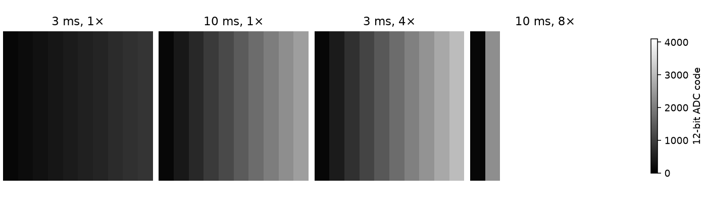

# Simulated camera measurements

Run `python -m experiments.run` from the repository root to reproduce these sweeps. Each table in the output directory has a PNG plot with the same stem. The decks record model parameters, stimuli, temperature, timing and saved nodes. All values below are model results unless identified as analytical predictions. [Numerical summary](../results/characterization/summary.txt) · [SPICE decks](../results/characterization/decks)

| Experiment | Observation |
|---|---|
| 1. Integration time | At full optical power, the 100 pF pixel cathode falls from 3 V to 2.8053 V at 1 ms and 1.0527 V at 10 ms. The ideal constant-current predictions are 2.8053 V and 1.0529 V. [Time sweep](../results/characterization/01_03_04_integration.csv) |
| 2. Incident power | At 10 ms the ADC input rises from 0.10023 V in darkness to 2.04701 V at 45 nW. The endpoint slope is 43.26 mV/nW. The predicted slope is 43.27 mV/nW. [Power sweep](../results/characterization/02_power_compression.csv) |
| 3. Exposure linearity and saturation | The ADC node reaches 3.0205 V at 15 ms, then only 3.0796 V at 25 ms. The integration follower has run out of low-side swing. At 1 s the reset memory's extra hold time also reduces the reported difference. [Exposure plot](../results/characterization/01_03_04_integration.png) |
| 4. Integration capacitor | At 1 ms, ADC voltages for 50, 100 and 220 pF are about 0.475, 0.295 and 0.190 V. Adding capacitance trades sensitivity for exposure headroom. At 10 ms the 50 pF pixel is already saturated. [Capacitance sweep](../results/characterization/01_03_04_integration.csv) |
| 5. Storage leakage | The exposed hold starts near 2.51 V at quarter light. Over 9.005 ms it loses about 216 mV with 100 MΩ leakage and 24 μV with 1 TΩ. The 1 TΩ RC-only prediction is about 23 μV. Bias and off-switch currents remain in the circuit. [Storage sweep](../results/characterization/05_storage.csv) |
| 6. Multiplexer | On the last bright-to-dark transition of a 2×2 scan, the signal bus settles to within 1 mV of its aperture voltage about 30 ns after select begins. A 3 ns bus RC plus the control threshold delay explains this scale. The complete chain needs much longer. [Readout sweep](../results/characterization/06_09_readout.csv) |
| 7. PGA | Measured low-frequency gains are 0.99999, 1.99996, 3.99984, 7.99936 and 15.99744 V/V. Bandwidth falls from 3.99 MHz at unity to 249.6 kHz at 16×. The bright end of the 8× image reaches 4.976 V at the ADC driver, above the ADC limit. [Gain and bandwidth](../results/characterization/07_gain.csv) |
| 8. CDS | At quarter light, a 100 mV sweep of the common reset offset changes the output by 99.982 mV with the nominal reference and about 2.6 μV with CDS. This experiment injects a known deterministic offset. [CDS sweep](../results/characterization/08_cds.csv) |
| 9. Filter | At τ = 2 μs, the measured cutoff is 79.47 kHz and equivalent noise bandwidth is 121.6 kHz. At τ = 5 μs the bandwidth falls to 49.5 kHz. The longer filter still leaves about 1.32 mV of bright-to-dark error at a 40 μs slot. Equivalent noise bandwidth is the integral of normalized squared gain, not a noise amplitude. [Bandwidth](../results/characterization/09_noise_bandwidth.csv) · [Settling](../results/characterization/06_09_readout.png) |
| 10. ADC | For 32 simulated gradient voltages, midpoint reconstruction gives RMS errors of 3.721, 0.949 and 0.249 mV at 8, 10 and 12 bits. The unclipped theoretical maximum errors are 6.445, 1.611 and 0.403 mV. [Quantization errors](../results/characterization/10_adc.csv) |
| 11. Global shutter | Inverting every optical input 1 μs after signal capture changes none of the four ADC codes. The sampled voltage changes are below solver resolution for this comparison. A separate regression moves a bright object during exposure and checks the time-weighted signal across both rows. [Post-shutter comparison](../results/characterization/11_shutter.csv) |
| 12. Images | Four full-array simulations acquire the same gradient at 3 or 10 ms and 1×, 4× or 8×. At 8× and 10 ms bright columns reach code 4095. Every matrix uses the corresponding ADC node trace. The file-input example also acquires an sRGB test card. [Image sweep](../results/characterization/12_images.csv) · [Test card and acquisition](../results/test_card) |

## Compressed acquisition

At 27 °C and 10 ms, the linear and diode modes give approximately 0.295 and 0.293 V at 4.5 nW. At 11.25 nW the outputs are approximately 0.587 and 0.465 V. By 45 nW the compressed output reaches only 0.562 V. The 11–45 nW interval illustrates operation above the knee in this configuration. At full light the compressed output falls from 0.6255 V at 0 °C to 0.5077 V at 50 °C, an average slope of about −2.36 mV/°C. The SPICE diode temperature law drives this effect. Dark and bias current sources remain fixed. Compression gives small bright-end voltage increments and makes uncalibrated brightness estimates temperature dependent. [Transfer curves](../results/characterization/02_power_compression.png)

## Electrical checks and tolerances

Run `python -m pytest -q`. The tests exercise actual ngspice decks, including the divider, one pixel, 2×2 and 10×10 scans, and all five amplifier configurations.

- The integration and array comparisons allow 1 mV absolute error for the dark, bias, lag, loading and offset terms missing from ideal charge integration. The raw-code provenance check requires exact integer equality.
- The storage test samples one nominal acquisition time constant after the reset-reference gate crosses its on threshold. Its 40 mV allowance on a multi-volt step includes interpolation across the switch edge. The long-hold test compares the measured loss to an RC exponential with a 2 μV allowance for bias and off-state current.
- Midband gain tolerance is 0.1% and cutoff tolerance is 2%. The latter covers finite loop gain, downstream poles, load resistance and interpolation between logarithmically spaced AC points.
- The shutter isolation check allows one quarter of a 12-bit LSB. Separate tests check ADC bin edges and clipping exactly. The CDS test allows 0.5 mV for residual correlated offset and 1 mV for bypass gain error.
- Tests also exercise input gamma decoding, moving illumination, analog saturation and compression. A failing shared-interface run is retried with batch ngspice. Truncated transients fail before reconstruction.

For the full 10×10 file-input test card, a separate batch run of the saved deck reproduced all 100 shared-library ADC voltages exactly on this host. Reducing both reltol and vntol by a factor of ten changed the sampled voltages by at most 8.97 μV, with a 2.39 μV RMS difference. This is a numerical sensitivity check for that scene and operating point.
